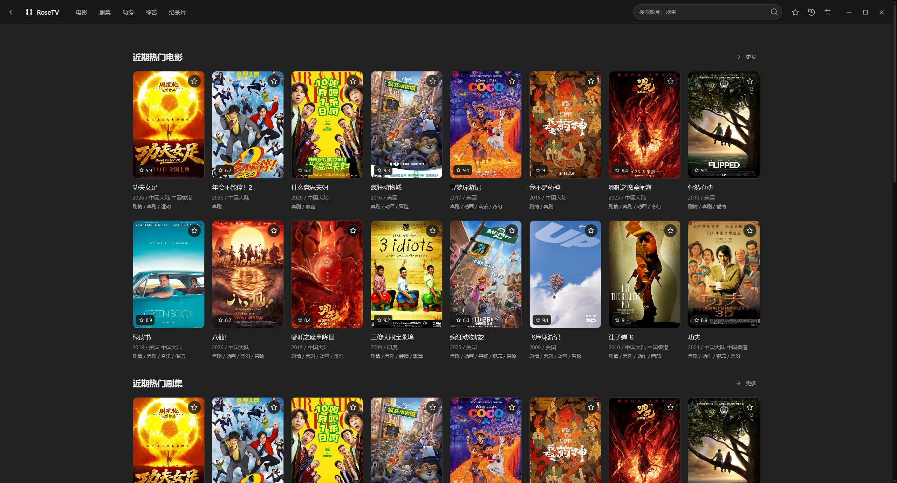
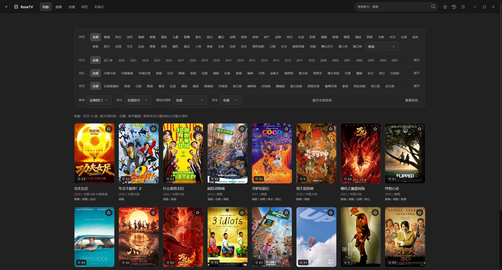

# RoseTV

RoseTV 是一款 Windows 桌面影视播放器，**基于 [LibreTV](https://github.com/LibreSpark/LibreTV) 和 [LibreTV-App](https://github.com/KeyRotate/LibreTV-App) 开发**。在上游的搜索、播放及 Tauri 桌面窗口基础上，增加了分类筛选、收藏、播放标签、小窗、本地缓存和请求调度等功能。

感谢上游项目及其贡献者。RoseTV 的命名和界面调整不改变上游代码的归属；许可证及署名见 [LICENSE](LICENSE)、[NOTICE.md](NOTICE.md)。

## 界面预览

首页：分类热门内容、搜索、收藏和观看记录。



电影页：类型、年代、地区、语言等组合筛选，海报右上角可直接收藏。



以上为实际软件界面，使用独立测试档案及已缓存的公开影片资料拍摄，不包含个人收藏、观看记录或账号资料。图片中的片单仅用于界面展示。

## 主要功能

- 电影、剧集、动漫、综艺、纪录片浏览，支持组合筛选、分页和搜索建议。
- 海报星标收藏、观看历史、继续观看，数据保存在本机。
- 独立播放标签、来源与线路切换、倍速、连续播放、全屏、可调整大小的小窗。
- 内置公开 API、添加兼容的自定义来源，以及专用网站登录窗口。
- 浅色、深色、跟随系统主题及强调色设置。
- 本地目录与海报缓存、存储占用统计、配置导入导出。

影片资料、播放地址和下载地址由第三方来源提供。影片出现在资料库中，不代表所选播放来源一定收录或当前可播放。

## 获取与启动

**下载或克隆仓库后，双击根目录的 `RoseTV.exe` 即可使用。** 源码和 Windows x64 运行环境一并提供，无需安装 Python、Node.js 或 Rust，也无需手动构建。

### 方法一：下载 ZIP 后直接使用

1. 点击绿色“Code → Download ZIP”，或直接[下载完整项目 ZIP](https://github.com/Rosetiny/RoseTV/archive/refs/heads/main.zip)。
2. 右键 ZIP，选择“全部解压缩”，解压到自己可写的文件夹。不要在压缩包内直接运行，也不要只提取 EXE。
3. 打开解压得到的 `RoseTV-main`，确认 `RoseTV.exe` 与 `source/`、`tools/`、`runtime/`、`vendor/` 位于同一层。
4. 双击这一层的 **`RoseTV.exe`**。首次启动自动校验、解压运行环境，准备桌面文件并生成自己的本机密钥；等待窗口出现即可。后续启动复用已准备的文件。
5. 在顶部选择电影、剧集等分类，或搜索影片。需要调整来源时，进入“设置 → 播放来源”，按下方说明操作。公开 API 不要求登录教父网站。

下载后的入口位置：

```text
RoseTV-main/
├─ RoseTV.exe                 ← 双击这里
├─ runtime/python-runtime.zip ← 随附运行环境，保留即可
├─ source/                    ← 可修改的源码
├─ tools/                     ← 启动和本地服务
├─ vendor/                    ← 已校验的桌面基底
└─ App/                       ← 首次启动后自动准备桌面文件
```

适用于 Windows 10 / 11 x64。桌面显示依赖 Microsoft Edge WebView2，多数系统已具备；若提示缺少 WebView2，可安装 [Microsoft 官方 WebView2 Runtime](https://developer.microsoft.com/microsoft-edge/webview2/consumer/)，再打开 `RoseTV.exe`。影视浏览和播放需要联网，运行环境首次准备不需要另行联网下载。

### 方法二：克隆源码后直接使用

已安装 Git 时，在 PowerShell 中运行：

```powershell
git clone https://github.com/Rosetiny/RoseTV.git
cd RoseTV
.\RoseTV.exe
```

克隆目录与 ZIP 方式包含相同的启动器、源码和运行环境，也可以从资源管理器双击根目录 `RoseTV.exe`。

### 启动、更新与分享

- 始终使用根目录 `RoseTV.exe`，首次启动无需寻找 `App/` 中的文件。
- 如果提示另一个目录的 RoseTV 正在运行，先关闭原窗口，再打开这一份。
- 更新源码前先关闭软件。修改嵌入的 JavaScript 后，下次启动自动更新桌面文件；修改主界面 `rosetv.js`、`rosetv.css` 后重启即可。
- 发给朋友时，发送从仓库下载的干净完整 ZIP。对方全部解压后双击根目录启动器；不要单发 EXE，也不要把自己用过的目录直接打包，避免带上账号、密钥和使用记录。
- 不同用户首次启动各自生成密钥和浏览器档案，需要登录的网站分别登录。详见 [构建与分发](docs/构建与分发.md)。

## API 与自定义来源配置

### 选择内置公开 API

1. 点击顶部“设置”图标，进入“播放来源”。
2. 勾选参与搜索、匹配和播放的来源，未勾选的来源不参与自动优选。
3. 可点击“测试全部内置来源”进行抽样检测，也可停止测试。检测完成后会选择评分靠前的来源，仍可手动调整。
4. 返回片单或搜索影片，点击海报；播放页可以继续切换来源和线路。

检测会实际检查五部固定样片的接口、分辨率及起播情况。`3/5 个样片可播`表示五部样片中三部通过，不能据此保证整个片库。测试会产生网络请求，不必每次启动重新测试。

### 添加自己的公开 API

进入“设置 → 播放来源”，点击“添加公开 API”，填写后点击“添加”。

| 字段 | 填写方式 |
| --- | --- |
| 名称 | 方便识别的名字，例如“我的影视来源” |
| API 地址 | 兼容接口的**基础地址**，例如 `https://api.example.com` |
| detail 地址（可选） | 详情使用不同域名时填写其基础地址；与搜索相同则留空 |
| 内容类别选项 | 根据来源实际内容选择，供内容过滤使用 |

**当前支持苹果 CMS 风格的 JSON 采集接口。** 软件会在基础地址后自动拼接：

```text
搜索：/api.php/provide/vod/?ac=videolist&wd=关键词&pg=1
详情：/api.php/provide/vod/?ac=videolist&ids=影片ID
```

例如，来源提供完整接口 `https://api.example.com/api.php/provide/vod/?ac=videolist`，表单只填 `https://api.example.com`。不要填完整接口、搜索参数、某部影片的网页或 `.m3u8` 地址，避免重复拼接路径。`example.com` 仅为格式示例，不能作为真实来源使用。

接口应返回 JSON 的 `list` 列表及 `vod_id`、`vod_name` 等字段；播放详情还需要 `vod_play_url` 等数据。XML 接口、其他路径或自定义签名协议需要修改适配代码后接入。添加网页首页不会自动解析任意电影网站。

添加后确认该来源已勾选。自定义来源保存在本机，可在列表中管理、移除；迁移时使用“存储与配置 → 导出配置 / 导入配置”。导出文件可能包含观看记录和私人来源地址，请自行保管。

### 连接需要登录的网站

公开 API 和账号网站是两种配置方式。教父来源使用专用网站适配器，不需要在公开 API 表单中填写账户或密码。

1. 在“设置 → 播放来源 → 自定义来源”检查“网站地址”的主用地址和备用网址。
2. 点击“登录 / 更换账号”，在专用浏览器窗口中正常登录并完成网站验证。
3. 返回软件，点击“保存登录状态”，确认成功并勾选该来源。
4. 地址变化时，可以“从发布页更新地址”，也可手动保存可信的主用与备用网址。不同域名分别保存会话，新域名可能需要重新登录。

网站限制访问或要求验证时，软件停止新增请求。备用网址用于地址维护，不用于绕过验证和限流。豆瓣用于影片资料，无需作为播放 API 添加。

### 添加后仍不能播放

| 现象 | 优先检查 |
| --- | --- |
| 搜不到影片 | 来源是否勾选、是否收录、名称是否准确，是否误填完整接口路径 |
| 搜索有结果，播放失败 | 详情、播放地址、CDN、编码及线路；尝试其他线路或来源 |
| HTTP 403 / 429 或要求验证 | 停止反复测试，按网站提示处理并等待恢复 |
| HTTP 502 / 超时 / 连接重置 | 上游可能暂时故障，稍后再试或更换可用来源 |
| 筛选无结果 | 查看页面提示；来源可能缺少语言、题材、画质或状态字段 |

## 缓存、速度与存储

- 优先使用本地已有数据；推荐结果通常复用 30 分钟，公开目录通常复用 6 小时。
- 每页展示 16 部；新目录请求按最多 64 条一批读取，再在本地拆页。实际批次大小取决于接口，旧批次缓存也会复用。
- 当前页显示后，按需预取接下来的两页。复用重复请求，前台操作优先，切换页面取消过时任务。
- 海报按可见范围加载，换页取消旧下载。首次访问仍受第三方网络和图片服务影响。
- 目录快照最多 8 MiB，影片资料缓存最多 512 KiB，主窗口网络缓存目标 32 MiB；浏览器档案另有占用，**32 MiB 不是全部存储的硬上限**。
- “清理接口缓存”保留收藏、历史、设置和登录会话；清理后首次访问需要重新获取片单，也不会删除完整登录浏览器档案。
- 存储页面显示磁盘总占用和明细；视频按播放流读取，不自动保存为整部影片文件。

请求调度可以减少重复访问，不能保证第三方服务永远可用，也不能保证任意点击速度下都没有等待。详见 [缓存与网络策略](docs/缓存与网络策略.md)。

## 本机数据与公开仓库

仓库包含维护中的源码、文档、测试及必要构建资产，不包含开发者的登录会话和使用记录。以下数据不应提交或放入发行包：

| 数据 | 本机位置或说明 |
| --- | --- |
| 本地服务密钥与设置 | `tools/bridge-config.json` |
| 加密的网站登录会话 | `tools/provider-session.bin`，使用 Windows 当前用户加密 |
| 专用登录浏览器档案 | `tools/provider-browser/`，包含 Cookie、网站存储和浏览器数据 |
| 收藏、历史及界面设置 | 主窗口 WebView2 的本机浏览器档案 |
| 缓存、下载和维护备份 | `Cache/`、`downloads/`、`backups/`、`build/` |
| 本机 Python 路径 | `tools/python-path.txt` |

这些路径已在 `.gitignore` 中排除。源码中的公开网站地址、测试假数据、配置字段名和占位符不是登录凭据。GitHub 账号、提交作者和提交时间仍按 GitHub 的正常规则公开显示。

## 自己改进代码

可以。遵守 [Apache License 2.0](LICENSE) 及相应依赖许可，即可学习、修改、构建和分发；修改后请保留上游版权和许可证说明。Fork 或克隆仓库后创建自己的分支即可开始。

技术构成：HTML / JavaScript / CSS 前端、Tauri 2 / Rust 桌面窗口、Python 本地适配服务和 C# Windows 启动器。当前构建核验原生基底并替换嵌入的前端资源，沿用上游原生内核；这与完整重编译 Rust / Tauri 是不同流程。

| 位置 | 用途 |
| --- | --- |
| `source/public/js/rosetv.js` | 桌面交互、片单、来源匹配、缓存调度、收藏和小窗 |
| `source/public/css/rosetv.css` | RoseTV 界面样式 |
| `source/public/js/config.js` | 内置 API 及接口路径配置 |
| `tools/rosetv_bridge.py` | 本地 HTTP 服务、资料、代理、缓存和窗口控制 |
| `tools/site_session.py` | 网站正常登录与加密会话 |
| `tools/Launcher.cs` | Windows 启动器 |
| `tools/build_local.py` | 构建和嵌入资源校验 |
| `source/src-tauri/` | 上游桌面原生源码 |
| `tools/test_*.py`、`source/tests/` | 离线回归检查 |
| `vendor/` | 已核验的压缩原生构建基底及说明 |

修改前先运行一次根目录 `RoseTV.exe`，随附运行环境会自动解压。之后可以直接编辑源码：

1. 关闭 RoseTV，修改上表对应文件。
2. 再次双击根目录 `RoseTV.exe`；JavaScript 嵌入资源会自动检查并准备，无需自己执行构建命令。
3. `rosetv.js` 和 `rosetv.css` 由本地服务读取，重启即可使用改动。
4. 修改 C# 启动器时，运行下列构建命令，再把 `build/RoseTV.exe` 复制到根目录。Rust / Tauri 原生代码的修改需要相应开发工具链，当前自动准备流程只更新前端资源。

使用随附 Python 运行离线检查和启动器构建：

```powershell
.\runtime\python\python.exe -m unittest discover -s tools -p "test_*.py" -q
.\runtime\python\python.exe tools/build_local.py
Copy-Item build/RoseTV.exe RoseTV.exe -Force
```

前端回归检查另需安装 Node.js，运行 `node source/tests/performance.mjs`；这只用于开发检查，普通使用无需安装。重制运行环境包见 [构建与分发](docs/构建与分发.md)。正式运行不启用调试端口。

GitHub Actions 执行离线检查和 Windows 构建，不向影片网站做压力测试。反馈问题时请附复现步骤和错误提示，上传截图、日志前先检查是否含私人地址、账号或历史记录。

## 更多说明

- [使用说明、登录资料与清理缓存](docs/使用说明.md)
- [构建与分发](docs/构建与分发.md)
- [缓存与网络策略](docs/缓存与网络策略.md)
- [来源维护](docs/来源维护.md)
- [验证说明](docs/本轮验证.md)
- [上游署名与许可证](NOTICE.md)

软件通过用户配置的第三方来源获取内容，不运营影片服务器。请仅使用有权访问的来源和内容，并遵守来源网站的使用要求。

